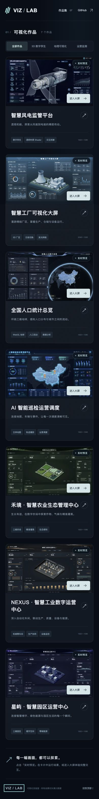
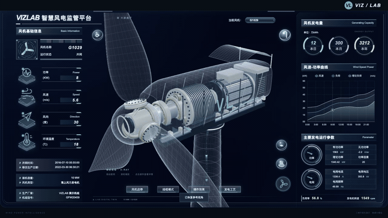
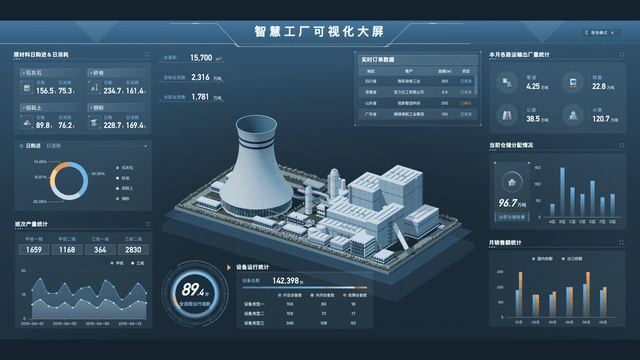
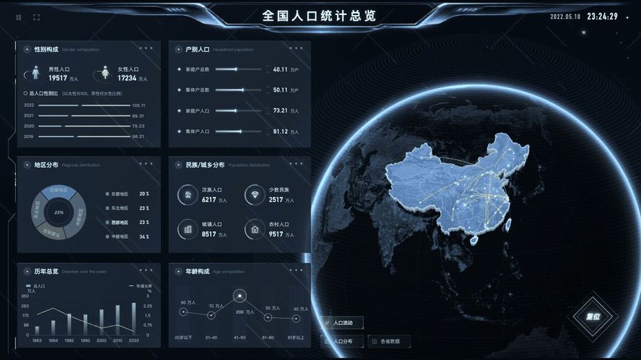
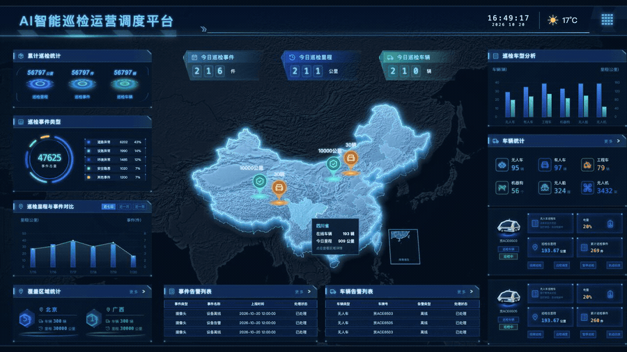
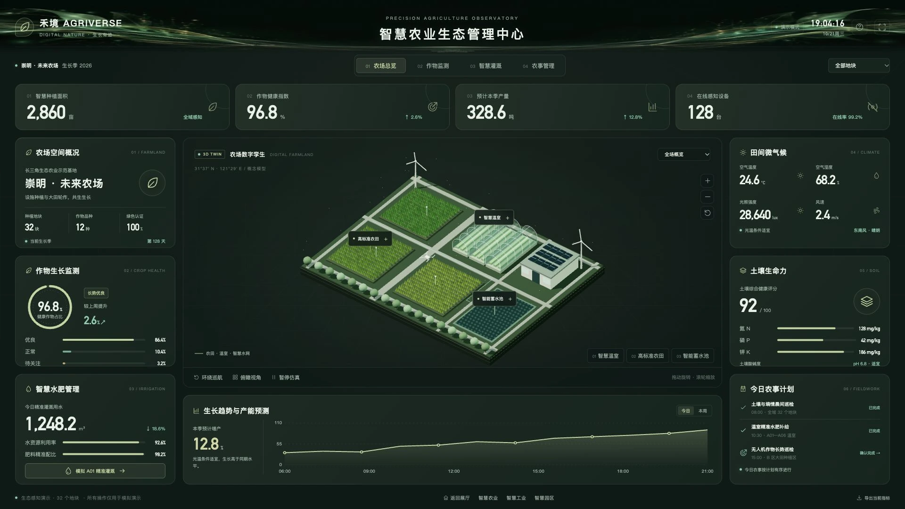
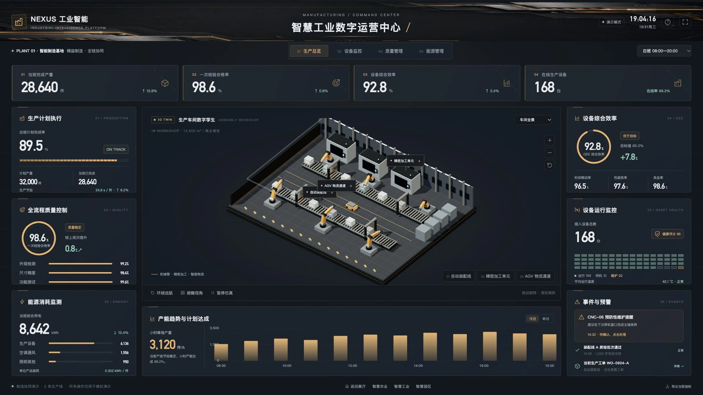
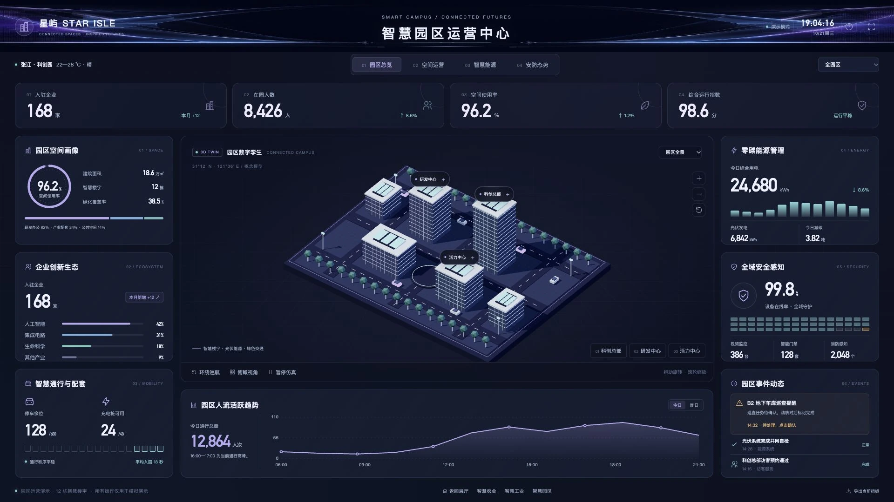

# VIZ / LAB · 可视化大屏展厅

[](https://github.com/yinweinidongle/screen-picture-demo/actions/workflows/ci.yml) [](LICENSE)

**[打开 Home 展厅](https://yinweinidongle.github.io/screen-picture-demo/home.html)** · [English](docs/README.en.md) · [参与贡献](CONTRIBUTING.md) · [路线图](ROADMAP.md)

七个可交互大屏，一座可以直接探索的作品展厅。用 Three.js、GLSL Shader 和 D3 展示精密机组、立体厂区、地球与运营地图。Home 卡片提供实际截图和实时场景预览，每次只运行一个场景。

[](https://yinweinidongle.github.io/screen-picture-demo/home.html)

<details>
<summary>手机首页预览</summary>
<br>

</details>

## 体验七个大屏

| 场景             | 核心交互                                                 | 在线体验                                                                                  |
| ---------------- | -------------------------------------------------------- | ----------------------------------------------------------------------------------------- |
| 智慧风电         | 透明机舱、部件点选、启停、环绕、线框、爆炸拆解与发电流光 | [wind.html](https://yinweinidongle.github.io/screen-picture-demo/wind.html)               |
| 智慧工厂         | 真实三维厂区、建筑点选、日夜扫光、极细发光网格与菲涅耳光 | [factory.html](https://yinweinidongle.github.io/screen-picture-demo/factory.html)         |
| 全国人口         | 拖动地球、人口迁徙、分布模式、省级数据与图表交互         | [population.html](https://yinweinidongle.github.io/screen-picture-demo/population.html)   |
| AI 智能巡检      | 地图厚度与辉光、省份悬停、车辆详情、轨迹回放与事件筛选   | [inspection.html](https://yinweinidongle.github.io/screen-picture-demo/inspection.html)   |
| 禾境 · 智慧农业  | 温室与农田、模拟灌溉、作物监测、区域指标与农事确认       | [agriculture.html](https://yinweinidongle.github.io/screen-picture-demo/agriculture.html) |
| NEXUS · 智慧工业 | 机械臂车间、班次计划、设备效率、工单与维护提醒           | [industry.html](https://yinweinidongle.github.io/screen-picture-demo/industry.html)       |
| 星屿 · 智慧园区  | 楼宇空间、绿色能源、安防态势、事件确认与对象详情         | [park.html](https://yinweinidongle.github.io/screen-picture-demo/park.html)               |

### 01 / 智慧风电

[](https://yinweinidongle.github.io/screen-picture-demo/wind.html)

### 02 / 智慧工厂

[](https://yinweinidongle.github.io/screen-picture-demo/factory.html)

[下载厂区 GLB](https://yinweinidongle.github.io/screen-picture-demo/factory-campus.glb) · [厂区实现说明](docs/screens/factory.md)

### 03 / 全国人口

[](https://yinweinidongle.github.io/screen-picture-demo/population.html)

### 04 / AI 智能巡检

[](https://yinweinidongle.github.io/screen-picture-demo/inspection.html)

### 05—07 / 农业 · 工业 · 园区

三套新增案例来自所有者的 [big-screen-astra](https://github.com/yinweinidongle/big-screen-astra)，经授权适配程序化模型，并重新设计布局、排版和交互。支持主题与指标联动、对象详情、仿真控制、CSV 导出、响应式布局和轻量场景回退。[实现与来源说明](docs/astra-cases.md)

[](https://yinweinidongle.github.io/screen-picture-demo/agriculture.html)

[](https://yinweinidongle.github.io/screen-picture-demo/industry.html)

[](https://yinweinidongle.github.io/screen-picture-demo/park.html)

## 本地开发

需要 **Node.js 22+** 和 **Python 3.10+**。CI 使用 Node.js 24、Python 3.13；依赖版本保存在 `package-lock.json` 和 `requirements.txt`。

```bash
git clone https://github.com/yinweinidongle/screen-picture-demo.git
cd screen-picture-demo
npm ci
npm run setup
npm run dev
```

打开 `http://127.0.0.1:5173/home.html`。保存源码后会重新构建，刷新页面查看。`setup` 创建项目 `.venv`，无需向系统 Python 安装依赖。

```bash
npm run build        # dist/ 网站 + dist/standalone/ 离线单文件 + 源码 ZIP
npm start            # 只预览已生成的 dist/，本机 5173 端口
npm run check        # JS 语法和大屏注册配置
npm test             # 构建契约与预览服务测试
npm run format:check # 统一格式
npx playwright install chromium
npm run test:browser # Chromium 交互，CI 另外保存截图和失败 trace
```

`npm run build:web` 只生成网站，`npm run build:standalone` 导出离线页。`build:wind`、`build:factory`、`build:population`、`build:inspection`、`build:home` 可单独更新目标。网站版使用本地托管的内容哈希资源，复用 Three.js/D3 并支持缓存；离线文件将依赖内嵌，不依赖 CDN。[离线文件目录](https://yinweinidongle.github.io/screen-picture-demo/standalone/home.html) · [完整源码包](https://yinweinidongle.github.io/screen-picture-demo/screen-picture-source.zip)。Home 实时预览推荐使用 HTTP。

## 从哪里改

```text
config/screens.json       大屏注册表：Home 卡片、入口、标签、尺寸
src/home/                 展厅模板、卡片模板、样式和预览管理
src/screens/<id>/         各大屏 template.html / styles.css / app.js / model.js
src/shared/runtime.js     舞台适配与清理回调
assets/                   本地依赖、地图、纹理、模型和预览；附来源清单
scripts/                  确定性构建、预览服务和新增大屏生成器
tests/                    构建、HTTP 服务与浏览器交互检查
docs/                     架构、素材、性能记录、场景说明和实际录屏
.github/                  CI / Pages、Issue 表单、PR 模板和依赖更新
```

新增大屏从 `npm run new:screen -- solar` 开始；Home 随注册表自动更新。详见 [贡献指南](CONTRIBUTING.md)、[新增大屏教程](docs/adding-a-screen.md)、[渲染架构](docs/architecture.md)。设计、模型、Shader、图表、测试、文档和无障碍都可以参与；从 [入门任务](https://github.com/yinweinidongle/screen-picture-demo/labels/good%20first%20issue) 认领一个聚焦的问题。

风机默认视角的绘制调用从 493 降为 131，几何对象从 379 降为 92；测量条件、限制和复现方式见 [性能记录](docs/performance.md)。浏览器截图供审阅，目前尚未建立跨 GPU 的像素级视觉回归基线。

## 发布与许可

PR 自动运行构建、格式、单元测试和 Chromium 交互检查；合并 `master` 后由 GitHub Actions 发布 `dist/` 到 Pages。`index.html` 和 `home.html` 均为展厅。开发者提交源码，生成目录不入库。

原创代码和程序化几何采用 **[MIT](LICENSE)**。地图、地形和地球纹理现均来自明确允许商用、修改和再分发的 **Natural Earth 公共领域数据**；工厂网格为原创 MIT 程序纹理。[素材声明](THIRD_PARTY_NOTICES.md)、[来源清单](assets/manifest.json) 和 [重建方法](docs/assets.md) 记录了出处与校验和。原有生成装饰图片单独列明，不纳入这次地图/纹理授权核验。

所有统计和设备控制均为演示。三维场景按单张参考图重建，未提供原始 CAD，不可见结构与尺寸为示意。大屏按固定设计比例适配窗口，横屏桌面效果最佳；Home 支持手机单列浏览。
