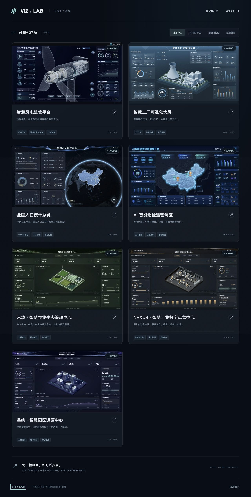

# VIZ / LAB — Interactive Dashboard Gallery

[Live gallery](https://yinweinidongle.github.io/screen-picture-demo/home.html) · [中文](../README.md) · [Contributing](../CONTRIBUTING.md)

Seven interactive scenes built with Three.js, custom GLSL and D3: a transparent wind turbine, a detailed factory with a day/night sweep, a draggable population globe, an inspection map with raised borders, precision agriculture, an automated workshop, and a smart campus. The gallery shows real previews and runs at most one live scene at a time.



Factory details: [English rendering guide](screens/factory.en.md).

The three new operations dashboards adapt owner-authorized procedural scenes from [big-screen-astra](https://github.com/yinweinidongle/big-screen-astra), with redesigned layouts, responsive charts, keyboard controls and lightweight fallbacks. See [implementation and provenance](astra-cases.md).

## Run locally

Install Node.js 22+ and Python 3.10+; CI uses Node 24 and Python 3.13.

```bash
git clone https://github.com/yinweinidongle/screen-picture-demo.git
cd screen-picture-demo
npm ci
npm run setup
npm run dev
```

Open `http://127.0.0.1:5173/home.html`. Source changes rebuild automatically; refresh to view them. `npm run setup` creates a project-local Python environment with the pinned Pillow version.

`npm run build` produces `dist/` with hashed, locally hosted web resources, `dist/standalone/` with embedded offline HTML, and a source ZIP. `npm start` serves an existing build. Use `npm run check`, `npm test`, `npm run format:check` and `npm run test:browser` before a PR. Install Chromium first with `npx playwright install chromium`.

Sources are in `src/screens/<id>/`; gallery metadata lives in `config/screens.json`. Run `npm run new:screen -- solar` for a registered starter. See [architecture](architecture.md), [the contribution guide](../CONTRIBUTING.md), and [the roadmap](../ROADMAP.md). Small improvements to charts, shaders, models, accessibility, tests and documentation are welcome.

Original code and procedural geometry use the [MIT license](../LICENSE). Current maps and geographic textures come from public-domain Natural Earth data, permitting commercial use, modification and redistribution. The factory grid is original MIT procedural material. Existing generated decoration and composite previews have separate provenance. Read [third-party notices](../THIRD_PARTY_NOTICES.md) before reusing assets. All device controls and statistics are simulated. The scenes are illustrative reconstructions, not engineering CAD models. Desktop landscape viewing is recommended; the gallery supports mobile layouts.
